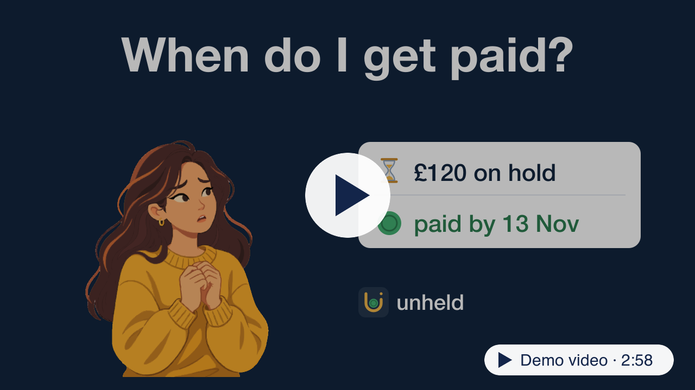

unheld answers one question for creators whose PayPal payment is on hold: "when does the creator get paid?"

## 🎥 Demo video

Hosted demo: <https://unheld.onrender.com> (access code in the Devpost testing instructions).

| Read more | |
|---|---|
| [How it works](docs/how-it-works.md) | The calendar, evidence, assistant and release rules, and how it uses AG Studio |
| [Run locally](docs/run-locally.md) | Setup and the PayPal sandbox test credentials |
| [Research](docs/research/README.md) | Why held payments: 268 of 3,655 public posts |
| [All docs](docs/README.md) | Screenshot, code map and links |
| [Privacy](PRIVACY.md) | What the app reads and keeps |

MIT licence ([`LICENSE`](LICENSE)). AG Grid and AG Studio are npm dependencies under their own commercial licence.
