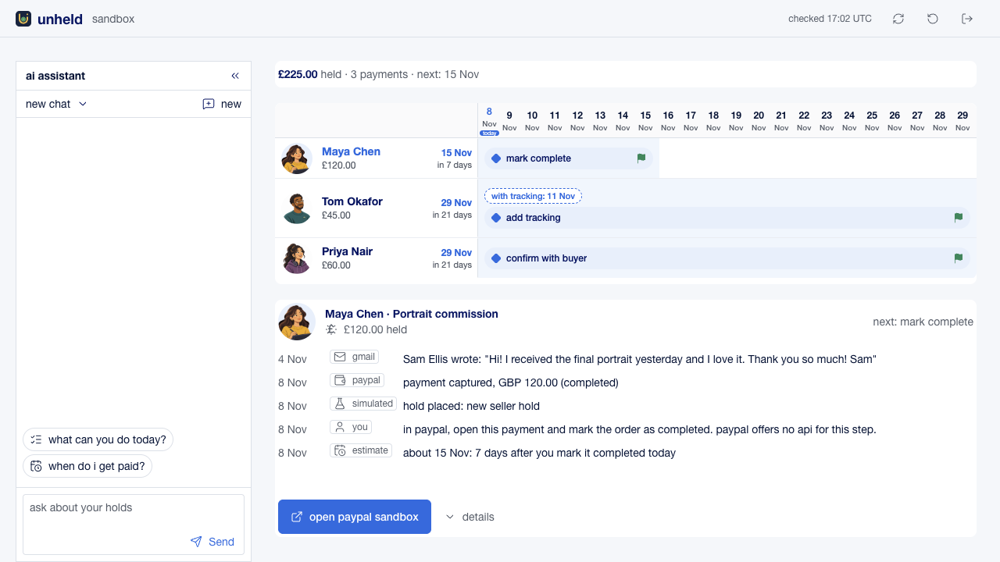

<p align="center"></p>

unheld helps independent creators answer "when does the creator get paid?" It shows held PayPal
payments in a calendar-gantt view, with the selected payment's evidence timeline below. An assistant
can explain an estimate, add tracking to a sandbox order, or save an unsent Gmail draft.

The idea came from 3,655 public posts about money problems, including 268 relevant held-payment
posts. The demo's bars show temporary hold only (111), limited or banned (78), support unreachable
(38), and needs it for rent, food or bills (21). Only 23 posts report a fix; others may not have followed up.



## Demo

- Hosted at <https://unheld.onrender.com>. The access code is in the Devpost testing instructions.
- Video `<TO FILL: YouTube URL>`

## How it works

- Calendar-gantt rows show creator avatars, amounts, paid-by estimates and hold bars. A dashed tracking bar previews a shorter wait; phones show a days-left list.
- The evidence timeline below labels each fact `paypal`, `simulated`, `gmail`, `you`, or `estimate`.
- The assistant uses `get_hold_evidence`, `add_tracking`, and `draft_buyer_reply`. Tracking writes to the sandbox order; Gmail drafts stay unsent until the creator chooses to send them.
- The live app computes release estimates from today's date under three rules, about 1 day after confirmed delivery, 7 days after the creator marks a digital service complete, or 21 days at the latest.
- The recorded demo gives Maya 13 Nov after her manual PayPal step, Tom about 9 Nov after tracking, and Priya 27 Nov at the latest. Priya still needs the buyer's reply.
- Holds are simulated and labelled because the PayPal sandbox never withholds money. Dates are estimates.

## How it uses AG Studio

The calendar in `app/studio/gantt-widget.tsx` uses AG Grid as a custom AG Studio widget. The evidence
widget adds source badges and a selection crossfade. Both use our Tailwind theme tokens, and the
three tools in `app/studio/ai.ts` ground Studio's built-in assistant in PayPal sandbox and Gmail evidence.

## Run locally

Requires Node.js 20.9 or later.

```bash
npm install
cp env.example .env.local   # then paste the sandbox values below into it
npm run seed
npm run dev
```

With the sandbox credentials below, this works as is. With your own PayPal sandbox app, run
`npm run seed -- --fresh` to seed new orders instead of reusing these ones. Gmail evidence is
optional and needs your own OAuth client and mailbox.

## Sandbox test credentials

| What | Value |
|---|---|
| PayPal sandbox client ID | `AaLBuM7uCdXwGHpfW0k2C8vJLd_LTW0cb8MuHvW2yD-rIs_di6E5-rTZsbET1r2vA9bKrct1naKTQqdj` |
| PayPal sandbox client secret | `EPItWsBRKKfLp69vA_j7zxEg1tsaPjM_AaFnu8YWJfUlU0H9Ciq8DuYheX1mUcg_da0du2z2DMTB9suR` |
| PayPal sandbox merchant email | `sb-47yi3w53561496@business.example.com` |
| PayPal sandbox test card | `4032039317984658`, expiry `2030-12`, CVV `123` |

## Licence

MIT for this code and its two icons (`LICENSE`). AG Grid and AG Studio are npm dependencies under
their own commercial licence; without a licence key, a trial watermark shows.

## Privacy

See [`PRIVACY.md`](PRIVACY.md).
